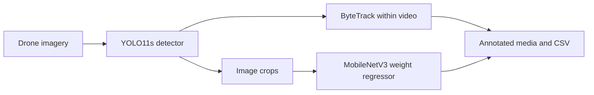

# boIA — AI for cattle monitoring

Research prototype for aerial cattle detection, video tracking and exploratory image-based weight estimation in Patagonia, Argentina.

## Architecture

## Notebooks

- [CowDB weight estimation experiment](notebooks/cowdb_weight_training.ipynb): animal-disjoint train/validation/test split, median baseline, transfer learning and MAE/RMSE evaluation.
- [Integrated inference pilot](notebooks/integrated_inference.ipynb): detection, tracking, weight regression and annotated image/video and CSV export.

## Getting started

Use Google Colab with a GPU for training. Install dependencies from requirements.txt or use the installation cells. Obtain authorized access to CowDB before downloading it. Train the regressor, supply your own trained YOLO11 cattle detector, and configure checkpoint paths in the inference notebook. The repository does not include either checkpoint or the original aerial detector training dataset.

## Limitations

Weight estimates from drone imagery are experimental, not validated livestock measurements. CowDB imagery is not established as representative of drone imagery. Tracking IDs are temporary and do not identify cattle across flights. CSV rows represent detections per frame, not unique animals. Field validation requires matched images and measured weights, with animal- and session-disjoint evaluation.

## Data and licensing

CowDB is provided by [Ganader-IA](https://huggingface.co/datasets/ganader-ia-developers/cowdb). Confirm dataset permissions before use or redistribution. No dataset images or weights are redistributed here. Check upstream Ultralytics licensing for intended deployment. No project license has been granted at this stage.

**Status:** research prototype; notebooks recovered and prepared for publication, not rerun as part of this release.
